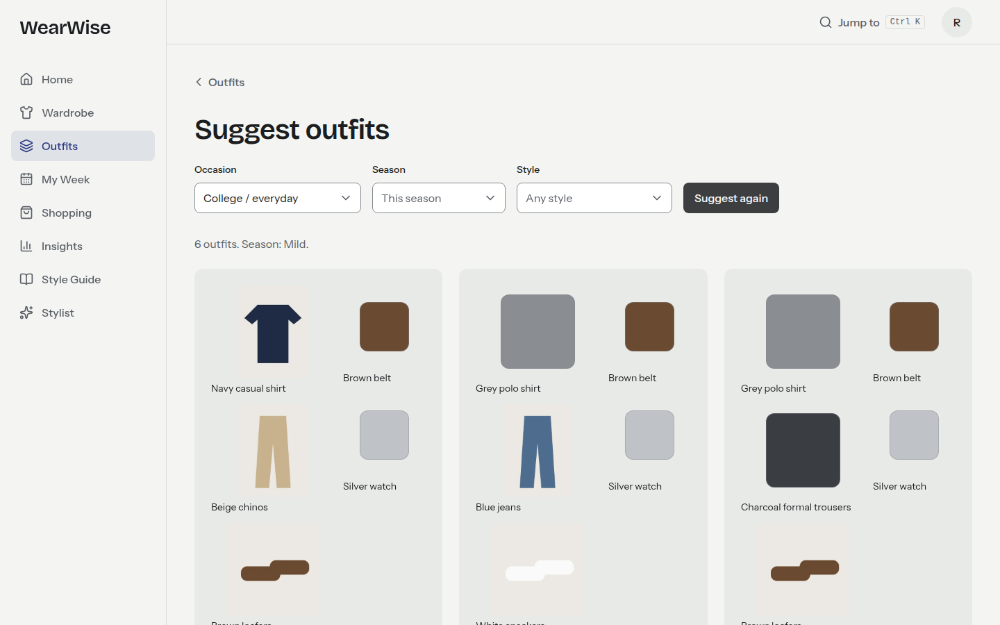
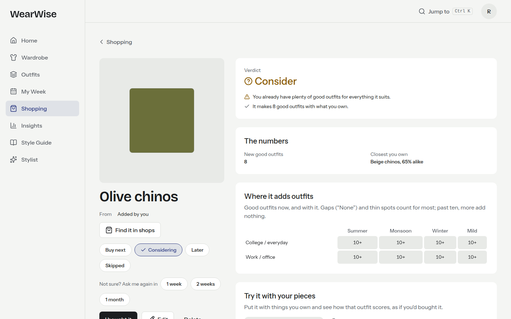
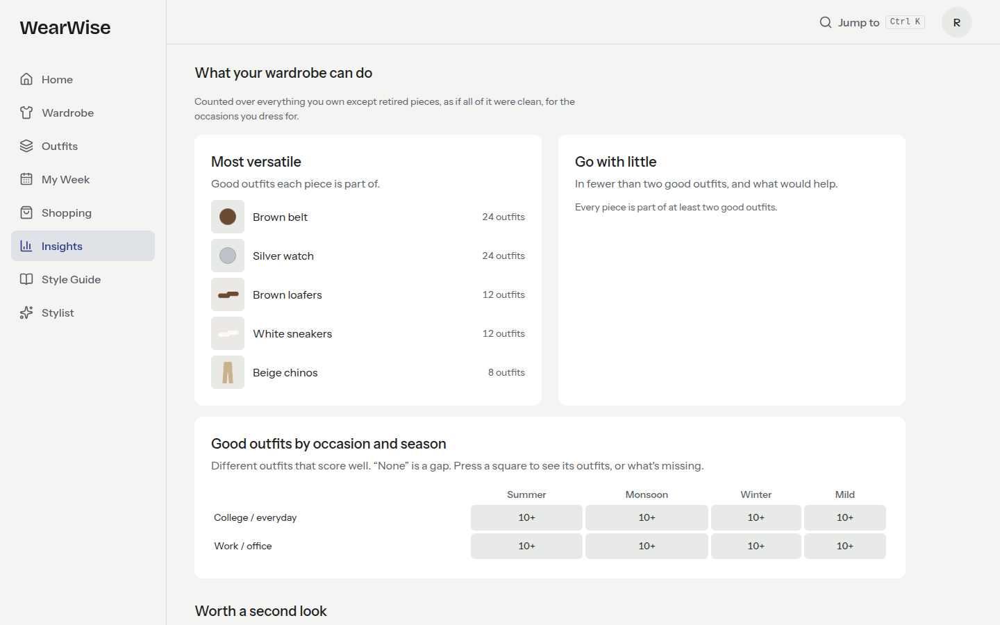
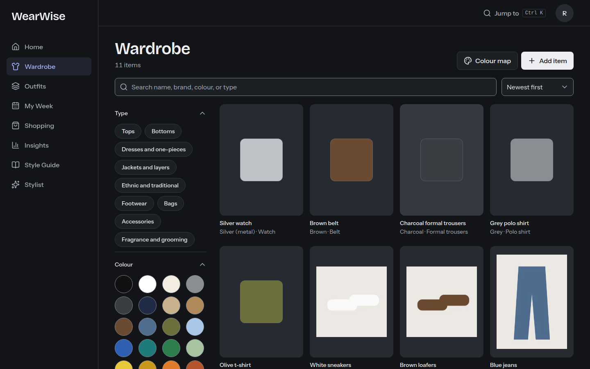
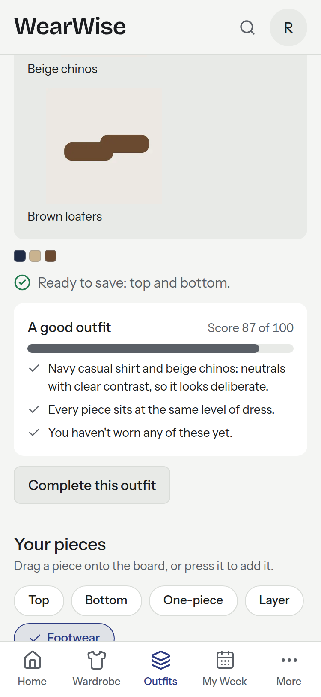
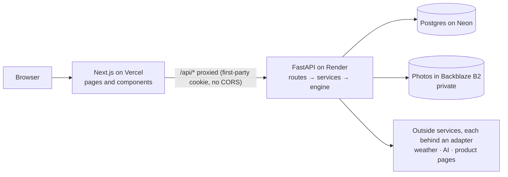

# WearWise

Know what to wear, see what your wardrobe is missing, and make every purchase count.

WearWise is a personal wardrobe and styling web app. You catalogue what you own, including shoes, accessories, and fragrance. It suggests outfits from those pieces and says why they work, plans your week around the weather and the laundry, and tells you what something would add before you buy it. It is not a store: there is no checkout, and when it points to a product you buy it on the shop's own site.

**Live:** https://wearwise-rouge.vercel.app. Press **Try the demo** for a sample wardrobe of your own, with no sign-up; it's deleted a day later. ([Privacy](https://wearwise-rouge.vercel.app/privacy))

<table>
  <tr>
    <td width="50%"></td>
    <td width="50%"></td>
  </tr>
  <tr>
    <td></td>
    <td></td>
  </tr>
</table>



## What it does

- **Wardrobe.** Add a piece with a photo and the colour is read from it. Search, filter by type, colour, season, and occasion, and see the wardrobe on a colour map.
- **Outfits.** Suggestions for an occasion, "what goes with this?", and "complete this outfit", each with plain reasons. Build your own by dragging pieces onto a board (or pressing them) and watch the score move. Like, dislike, or swipe on a phone; what you react to changes what comes first next time.
- **My Week.** Seven days planned around your usual week, events, the forecast for your city, and what's clean. A laundry view, and packing lists for trips.
- **Insights.** What you wear most and least, cost per wear where you've given a price, which pieces go with the most and which are stranded (and what would help), and how many good outfits you have for each occasion and season. A 60-day "wear what you own" challenge, counted from the wear log.
- **Smart Shopping.** Buy, Consider, or Skip for anything you're thinking of buying, from the outfits it would add and what you already own that's close. Try it on with your own pieces, sleep on it with a reminder, compare candidates, see which staples would add the most, plan a starter wardrobe in stages on a budget, and find real products through shop searches or a pasted link.
- **Stylist.** A chat that answers from your own items, plans, and shopping list, and changes nothing without your confirmation. Off unless an API key is set.
- **Your data.** Download everything as a zip, delete your account and every photo at once, and a [privacy page](https://wearwise-rouge.vercel.app/privacy) that says who sees what.

## How it works



The backend is one service in layers: `api/` (routes and schemas), `services/` (the use cases, every query filtered by the logged-in person), `engine/` (the rules), and `adapters/` (anything outside, each with a timeout, a fallback, and a fake for tests). The engine imports nothing from the rest of the app, and a test enforces it: it takes plain data and returns plain data, so it is tested in milliseconds and the stylist calls the same functions the buttons do.

### The outfit engine, in brief

It's deterministic Python, not a model. For an occasion it:

1. **Filters** what can't be used: anything not at hand or due a wash, out of season, in a colour you avoid, or far from the occasion's level of dress.
2. **Picks templates** the rest can fill: top, bottom, and footwear; a one-piece and footwear; or a saree, its blouse, and footwear; each with an optional layer. Templates are data in `seed/`, so a new garment structure needs no code.
3. **Generates** combinations: every one for a small wardrobe, a beam search keeping the best 200 partial outfits for a large one.
4. **Scores** each pair of pieces from 0 to 1: colour (35%, in the OKLCH colour space, so "goes with" follows how people see colour), formality (30%), pattern (15%), fabric and season (10%), and style (10%), plus what you've taught it by liking and disliking. An outfit's base is `0.7 × weighted mean + 0.3 × worst pair`, so one clash pulls a whole outfit down, with penalties for too many hues or patterns.
5. **Fits the day**: half the score is that base, and the rest is the occasion's level of dress, the weather, rotation (not worn lately), your preferences, and your styles.
6. **Finishes** the best with a belt, watch, bag, or fragrance where they fit, picks results that differ from each other, and **explains** each one from its strongest parts.

The purchase check runs the same engine with and without the candidate and counts what changes: new good outfits for each occasion and season (where you have few, they count for more), how close it is to something you own, and what it duplicates. Details: [`docs/ENGINE.md`](docs/ENGINE.md), [`docs/SHOPPING.md`](docs/SHOPPING.md).

## Stack

| Layer | Choice |
|---|---|
| Frontend | Next.js (App Router), React, TypeScript, Tailwind CSS, Radix primitives, TanStack Query |
| Backend | FastAPI, Pydantic, SQLAlchemy 2, Alembic, PostgreSQL |
| API contract | TypeScript types generated from the OpenAPI schema; CI fails if they're stale |
| Tests | pytest with hypothesis (property tests); Vitest and Testing Library; Playwright with axe |
| Hosting | Vercel (web), Render (API), Neon (database), Backblaze B2 (photos) |

Why each: [`docs/ARCHITECTURE.md`](docs/ARCHITECTURE.md) and [`docs/DECISIONS.md`](docs/DECISIONS.md).

## Quick start

You need [Docker](https://docs.docker.com/get-docker/), [uv](https://docs.astral.sh/uv/getting-started/installation/), Node.js 22, and pnpm 10 (`npm install -g pnpm@10`).

```bash
git clone https://github.com/krish1809/wearwise.git
cd wearwise
make setup   # install dependencies; create .env from .env.example
make dev     # start Postgres, apply migrations, run the API on :8000 and the web app on :3000
```

Open http://localhost:3000 and press **Try the demo**, or create an account. The API's interactive docs are at http://localhost:8000/docs. The local database runs in Docker on port 5433, so it doesn't clash with a Postgres already on your machine.

## Commands

Run `make` to list them all.

| Command | What it does |
|---|---|
| `make dev` | Start Postgres, apply migrations, run the API and the web app; Ctrl+C stops both |
| `make test` | Backend tests (against a throwaway `wearwise_test` database) and frontend tests |
| `make e2e` | End-to-end tests in a browser, against `make dev` (or `E2E_BASE_URL`) |
| `make lint` / `make format` | Lint and formatting checks / fix them |
| `make typecheck` | mypy for the backend, TypeScript for the frontend |
| `make migration m="add users"` | Create a migration from changed models |
| `make migrate` | Apply migrations, then load the reference data in `seed/` |
| `make api-types` | Regenerate the frontend's API types after changing a route |
| `make audit` | Check the packages the live app runs on for known vulnerabilities |
| `make housekeeping` | Remove what has expired: old demos, unsaved photos, old error reports |
| `make check` | Lint, types, tests, and the production build, as CI runs them |

## Testing

- **Backend:** about 500 tests. Unit tests for every scoring rule; property tests (hypothesis) for the engine's promises, such as one item per slot and never exceeding a budget; API tests against a real Postgres, including, for every feature, a second person getting 404 for the first one's data. A golden-set check is ready for a real wardrobe's hand-labelled outfits, and waits on the labels.
- **Checks that walk every route:** each one needs a login (except a short public list), each change needs the anti-forgery header, and an id that isn't there is a 404, never a crash. Every table is either a person's (exported and deleted with them) or explicitly shared, and every link to a person's data is indexed.
- **Frontend:** component tests with Vitest and Testing Library, and a contrast test for every colour pair in both themes.
- **End to end:** Playwright runs the five main journeys (sign up, add an item with a photo, build an outfit, get suggestions, check a purchase), then deletes the account; axe checks twenty pages in both themes for accessibility problems and sideways scrolling; and keyboard checks cover the skip link, focus rings, and dialogs. At desktop and phone size, on every pull request against a fresh stack, and daily against the live site.

## Security and privacy

Sessions are opaque tokens in an `httpOnly`, `SameSite=Lax` cookie, with only a hash stored, and passwords are hashed with Argon2id. Every change needs a custom header that other sites can't send, and every route that touches a person's data filters by the logged-in person. The web app sends a content security policy and the usual security headers. Uploads are decoded only as JPEG, PNG, or WebP, stripped of location data, and re-encoded. Logins, sign-ups, uploads, and every person's changes are rate-limited. Errors and logs carry a request id but no query strings or IP addresses. Dependencies are audited weekly. What is stored and who sees it: the [privacy page](https://wearwise-rouge.vercel.app/privacy).

## Known limitations

- On Render's free plan the API sleeps after 15 quiet minutes, so the first request afterwards takes up to a minute; the site says so while it waits. The free plan's small CPU also makes Insights slow the first time after a change on a large wardrobe (a few hundred pieces); later visits use a saved copy.
- No password reset by email yet: it needs an email provider. Until then, a forgotten password means a new account.
- The email address can't be changed yet; the name can.
- Without a city or a weather setting, suggestions and plans go by the season.
- The server's "today" is the UTC day, so in India its new day starts at 05:30.
- Dragging pieces onto the board works with a mouse; on a phone, pieces are pressed instead.
- iPhone HEIC photos upload from Safari, which converts them; other browsers may not.
- Photos aren't backed up, and outfits suggested to you are kept with your account to measure how well suggestions work.
- Demo wardrobes have no photos: each piece shows its colour instead.
- The `make` commands assume Linux or macOS; on Windows, use WSL.

## Documentation

| Document | Contents |
|---|---|
| [Product spec](docs/PRODUCT_SPEC.md) | Features, pages, principles, definition of done |
| [Roadmap](docs/ROADMAP.md) | Milestones M0 to M12 |
| [Architecture](docs/ARCHITECTURE.md) | Structure, auth, images, conventions |
| [Data model](docs/DATA_MODEL.md) | Tables |
| [Engine](docs/ENGINE.md) | Scoring, generation, planner |
| [Shopping](docs/SHOPPING.md) | Purchase analyzer, product sources |
| [AI](docs/AI.md) | Photo tagging, the stylist |
| [Agents](docs/AGENTS.md) | Planned for M12: a Trend Scout, a weekly email of what's worth buying, and the stylist as an agent graph |
| [Design system](docs/DESIGN_SYSTEM.md) | Visual direction, both themes, components |
| [Deployment](docs/DEPLOYMENT.md) | Hosting, release, observability |
| [Decisions](docs/DECISIONS.md) | Choices made and why |
| [Progress](docs/PROGRESS.md) | Milestones and the log |

## Making a change

1. **Model** in `backend/app/models/`, then `make migration m="..."`; read the generated file before applying it.
2. **Service** in `backend/app/services/`, with every query filtered by the current person.
3. **Rules** (scoring, planning, analysis) in `backend/app/engine/` as plain functions with unit tests.
4. **Route** in `backend/app/api/`, with tests, including one where a second person gets 404.
5. `make api-types`, then the **page** in `frontend/app/` with the typed client in `frontend/lib/api/`.
6. `make check` and `make e2e` before opening a pull request. CI runs them too, and `main` deploys once they pass.
